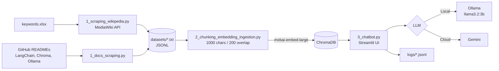

# 🦜 Hybrid RAG Chatbot (Ollama + Gemini)

A Retrieval-Augmented Generation (RAG) chatbot that answers questions **only from your own document corpus**. It scrapes Wikipedia and GitHub documentation, embeds the content into a **ChromaDB** vector store, and serves a **Streamlit** chat interface that can run fully **local with Ollama** or in the cloud with **Google Gemini**.


---

## ✨ Features

- **Hybrid LLM backend**: switch between a local Ollama model (`llama3.2:3b`) and cloud Gemini (`gemini-pro-latest`) from the sidebar.
- **Hybrid retrieval**: combines ChromaDB vector similarity with a keyword-match boost, then re-ranks the top results.
- **Confidence scoring**: every answer gets a retrieval confidence score derived from keyword overlap with the retrieved passages.
- **Hallucination guard**: if confidence falls below 30, the bot replies _"I don't know based on the provided documents."_ instead of guessing.
- **Strict grounded answers**: the system prompt forces answers from the retrieved context only, with numbered source citations (`[1]`, `[2]`, ...).
- **Answering modes**: _Study (detailed)_, _Quick (concise)_, _Exam (step-by-step)_.
- **Audience levels**: _Simple_, _Normal_, _Advanced_.
- **Small-talk bypass**: greetings are handled without triggering retrieval.
- **Source inspection**: optionally display the retrieved passages in the UI.
- **Interaction logging**: every Q&A (question, answer, model, confidence, sources) is appended to a daily `logs/chatlog_YYYYMMDD.jsonl` file.

---

## 🏗️ Architecture



**Pipeline in three stages**

| Stage      | Script                                          | What it does                                                                                                                                                                             |
| ---------- | ----------------------------------------------- | ---------------------------------------------------------------------------------------------------------------------------------------------------------------------------------------- |
| 1. Collect | `1_scraping_wikipedia.py`, `1_docs_scraping.py` | Fetches full Wikipedia articles for each keyword in `keywords.xlsx` and the READMEs of LangChain, Chroma and Ollama. Output is saved as JSONL in `datasets/`.                            |
| 2. Index   | `2_chunking_embedding_ingestion.py`             | Loads all dataset files, splits them with `RecursiveCharacterTextSplitter` (chunk size 1000, overlap 200), embeds each chunk with Ollama `mxbai-embed-large`, and stores it in ChromaDB. |
| 3. Chat    | `3_chatbot.py`                                  | Streamlit app that retrieves the top 6 chunks, re-ranks them, builds a grounded prompt, and queries the selected LLM.                                                                    |

---

## 📁 Project Structure

```
.
├── 1_scraping_wikipedia.py          # Wikipedia scraper (MediaWiki API)
├── 1_docs_scraping.py               # GitHub README scraper
├── 2_chunking_embedding_ingestion.py# Chunking, embedding, ChromaDB ingestion
├── 3_chatbot.py                     # Streamlit RAG chatbot
├── example_chunking.py              # Standalone chunking example
├── example_embedding.py             # Standalone embedding example
├── example_retriever.py             # Standalone retrieval example
├── test.py                          # Lists available Gemini models
├── keywords.xlsx                    # Wikipedia search keywords
├── requirements.txt
├── .env.example                     # Environment variable template
├── datasets/                        # Generated (git-ignored)
├── chroma_db/                       # Generated (git-ignored)
└── logs/                            # Chat interaction logs
```

---

## 🚀 Getting Started

### Prerequisites

- Python 3.11+
- [Ollama](https://ollama.com/download) installed and running
- A [Google AI Studio](https://aistudio.google.com/) API key _(only needed for the Gemini option)_

### 1. Clone the repository

```bash
git clone https://github.com/Husseinch24/Python-Teaching-Chatbot.git
cd Python-Teaching-Chatbot
```

### 2. Create and activate a virtual environment

```bash
python -m venv venv

# Windows
venv\Scripts\activate

# macOS / Linux
source venv/bin/activate
```

### 3. Install dependencies

```bash
pip install -r requirements.txt
```

### 4. Pull the Ollama models

```bash
ollama pull mxbai-embed-large
ollama pull llama3.2:3b
```

### 5. Configure environment variables

```bash
# Windows
copy .env.example .env

# macOS / Linux
cp .env.example .env
```

Open `.env` and set `GEMINI_API_KEY` if you want to use Gemini. Ollama works without any API key.

| Variable                 | Description                  | Default             |
| ------------------------ | ---------------------------- | ------------------- |
| `EMBEDDING_MODEL`        | Ollama embedding model       | `mxbai-embed-large` |
| `CHAT_MODEL`             | Ollama chat model            | `llama3.2:3b`       |
| `MODEL_PROVIDER`         | LLM provider for LangChain   | `ollama`            |
| `GEMINI_API_KEY`         | Google Gemini API key        | _(empty)_           |
| `DATASET_STORAGE_FOLDER` | Where scraped data is stored | `datasets/`         |
| `DATABASE_LOCATION`      | ChromaDB persistence folder  | `chroma_db`         |
| `COLLECTION_NAME`        | ChromaDB collection name     | `rag_data`          |

---

## ▶️ Usage

Run the three stages in order:

```bash
# 1. Collect data
python 1_scraping_wikipedia.py
python 1_docs_scraping.py

# 2. Chunk, embed and index
python 2_chunking_embedding_ingestion.py

# 3. Launch the chatbot
streamlit run 3_chatbot.py
```

The app opens at `http://localhost:8501`.

> ⚠️ Stop Streamlit before re-running step 2. The ingestion script deletes and rebuilds the ChromaDB folder.

### Customize the knowledge base

- **Wikipedia topics**: edit `keywords.xlsx` and add one topic per row in the `Keyword` column.
- **Documentation sources**: add entries (`url`, `title`) to the `SOURCES` list in `1_docs_scraping.py`.
- Re-run stages 1 and 2 to rebuild the index.

---

## 🧠 How Retrieval Works

1. The question is embedded and the top **6** chunks are fetched from ChromaDB with `similarity_search_with_score`.
2. Each chunk gets a **hybrid score** = inverted vector distance + `0.5 × keyword matches` (query words longer than 3 characters).
3. Chunks are re-ranked by hybrid score.
4. **Confidence** = `40 + 15 × average keyword matches` (capped at 100).
5. Below the confidence threshold of 30, the bot refuses to answer. Otherwise the context, chat history and mode/audience rules are sent to the LLM.

---

## 🛠️ Tech Stack

- **Orchestration**: LangChain
- **Vector database**: ChromaDB
- **Embeddings**: Ollama `mxbai-embed-large`
- **LLMs**: Ollama `llama3.2:3b` (local), Google Gemini (cloud)
- **UI**: Streamlit
- **Data collection**: Requests, MediaWiki API, pandas, openpyxl

---

## 🗺️ Roadmap

- [ ] Add PDF and local-file ingestion
- [ ] Replace the keyword-based confidence with a cross-encoder re-ranker
- [ ] Add retrieval evaluation (hit rate, MRR) and answer-faithfulness metrics
- [ ] Dockerize the application
- [ ] Add a FastAPI endpoint alongside the Streamlit UI

---
